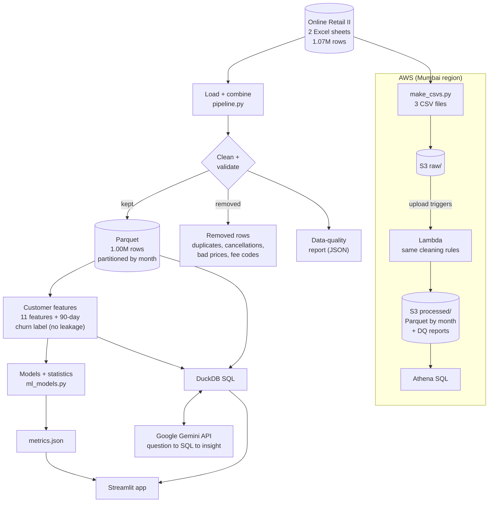
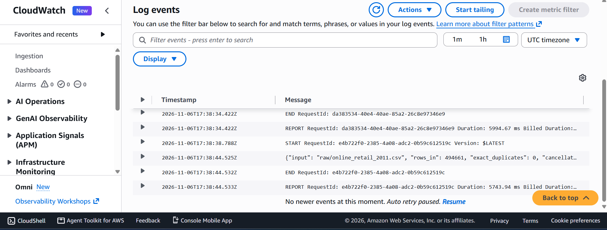
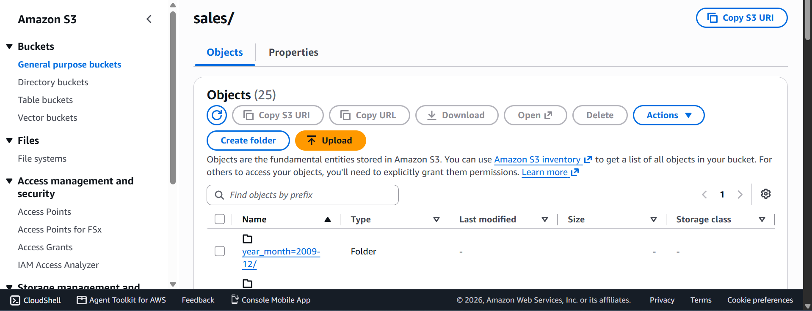
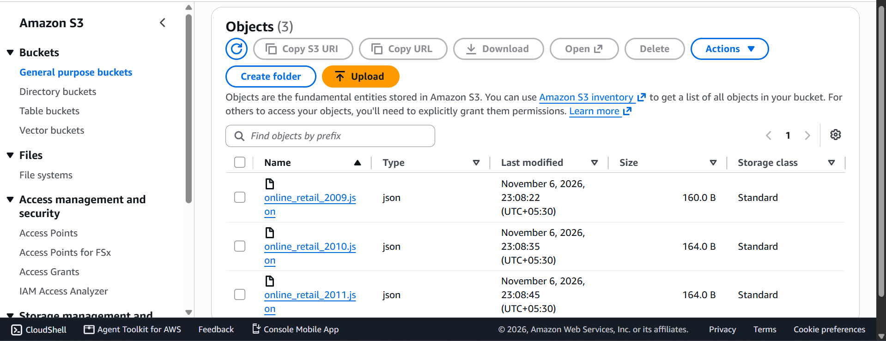
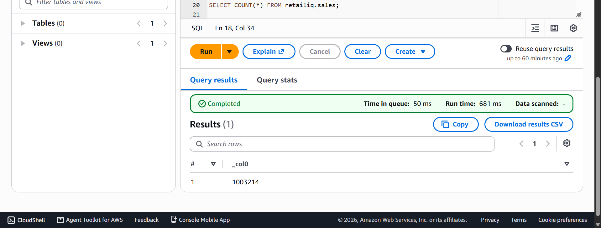
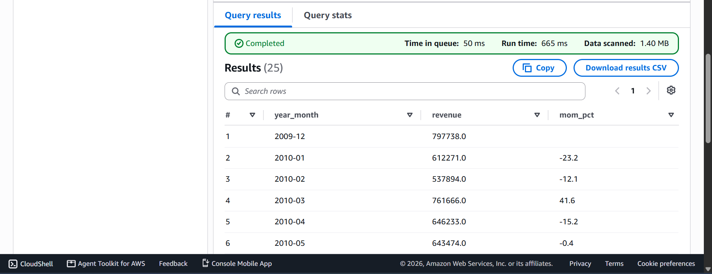
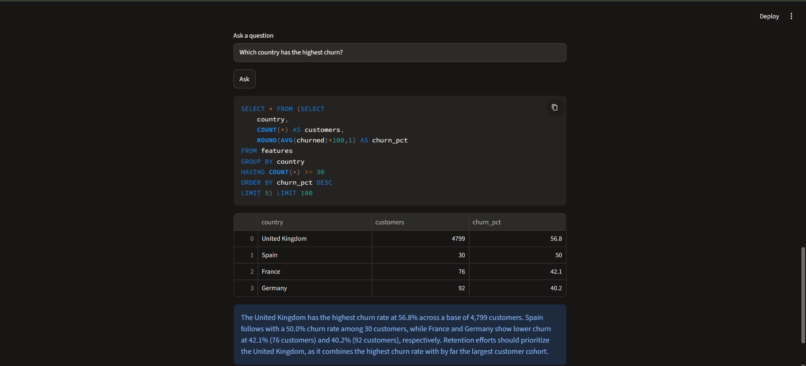

# RetailIQ: Customer Churn Analytics Pipeline on AWS

A data engineering and data science project on the real **UCI Online Retail II** dataset (1.07M transactions, Dec 2009 to Dec 2011).
It cleans the data, deploys the cleaning step on AWS (S3, Lambda, Athena), predicts which customers will churn, forecasts monthly revenue, and answers questions in plain English with the Google Gemini API.

## Architecture



## What it does

1. **Cleans 1.07M raw rows into 1.00M reliable rows** and writes month-partitioned Parquet plus a data-quality report.
2. **Runs the same cleaning on AWS:** a CSV uploaded to S3 triggers a Lambda function, and the result is queried with Athena SQL. The row count matches the local pipeline exactly (1,003,214).
3. **Builds a leakage-safe churn dataset** for 5,256 customers: 11 features from before a cutoff date, and a label for "no purchase in the 90 days after".
4. **Compares models:** Logistic Regression, Decision Tree, Bagging and Gradient Boosting, plus linear regression for spend, revenue forecasting and non-parametric tests.
5. **Answers questions in English:** Gemini writes the SQL, DuckDB runs it, Gemini explains the result. A Streamlit page shows it.

## Results

| Item | Result |
|---|---|
| Clean rows / customers | 1,003,214 / 5,256 (56.4% churn) |
| Churn test AUC | Logistic 0.80, Boosting 0.80, Bagging 0.79, Decision Tree 0.78 |
| Top churn drivers | days since last order, gap between orders, total spend |
| Churn by number of orders | 1 order: 79%, 2-3: 64%, 4-9: 45%, 10+: 16% |
| Revenue forecast (3-month holdout) | seasonal-naive MAPE 5.9% vs about 35% for trend-only Holt |
| Spend, churned vs retained customers | median 476 vs 1,583 (Mann-Whitney p < 1e-190) |

## Screenshots

### AWS pipeline (S3, Lambda, Athena)

| Lambda run (CloudWatch log) | Partitioned Parquet in S3 |
|:---:|:---:|
|  |  |
| **Data-quality reports in S3** | **Athena row count (1,003,214)** |
|  |  |

| Athena: monthly revenue with month-over-month growth |
|:---:|
|  |

### Streamlit app with Gemini

| Ask your data in plain English |
|:---:|
|  |

## How it works

### 1. Cleaning (`src/pipeline.py`, same rules in `aws/lambda_handler.py`)

| Rule | Rows removed | Reason |
|---|---|---|
| Exact duplicate rows | 34,335 | Includes the 1-9 Dec 2010 overlap between the two yearly sheets |
| Invoice starts with "C" | 19,104 | Cancellations and returns (kept separately for a return-rate feature) |
| Quantity or price <= 0 | 6,019 | Write-offs and price adjustments, not sales |
| Non-product stock codes | 4,699 | POST, BANK CHARGES and similar fees. Real products start with 5 digits |
| Missing customer ID | 226,637 | Kept for revenue totals, left out of customer models |

Revenue is `amount = quantity x price`. Output is Parquet partitioned by `year_month`, the layout Athena reads.

### 2. Leakage-safe features
`cutoff` = last date in the data minus 90 days. Features (recency, frequency, spend, average order value, items per order, distinct products, tenure, gap between orders, UK flag, returns, return rate) use only purchases **before** the cutoff. The label `churned = 1` means no purchase **after** the cutoff. Computing both from the same period would make the model look perfect and be useless.

### 3. Models (`src/ml_models.py`)
- 75/25 split, stratified, `random_state=42`, plus 5-fold cross-validation on the training set.
- Metric: ROC-AUC, because it measures how well churners are ranked above non-churners.
- Skewed columns are log-transformed for the linear models. Logistic Regression is scaled; trees are not.
- Forecast: last 3 months held out. A 12-month seasonal Holt-Winters model was not fitted, because it needs 24+ months and only 23 full months exist.
- Non-parametric tests (Mann-Whitney, Kruskal-Wallis, Spearman) are used because spend is heavily skewed.

### 4. Gemini layer (`src/genai_insights.py`)
Question -> Gemini writes one SQL query -> **guardrail** (SELECT or WITH only, no semicolons, blocked keywords, `LIMIT 100`) -> DuckDB runs it on the Parquet files -> Gemini writes a short insight using only the returned numbers.
Prompt rules require group sizes and a minimum of 30 customers per group. This was added after the model once reported "Brazil has the highest churn" based on 2 customers. The code retries busy models, tries other Gemini Flash models, and falls back to an offline demo mode without a key.

### 5. AWS pipeline (built in the AWS console, Mumbai region)
`make_csvs.py` writes 3 yearly CSV files -> uploaded to `s3://<bucket>/raw/` -> an S3 trigger starts a Python 3.12 Lambda (3008 MB, 15 min) using the AWS SDK for pandas layer -> Lambda cleans the file and writes month-partitioned Parquet to `processed/sales/` and a JSON data-quality report to `processed/dq_reports/` -> Athena table `retailiq.sales` (`aws/athena.sql`). Lambda row counts: 43,295 + 478,236 + 481,683 = 1,003,214, identical to the local pipeline.

## How to run

### Local (Windows CMD)
```
git clone https://github.com/bhumikabhoyar/retailiq.git
cd retailiq
python -m venv venv
venv\Scripts\activate
pip install -r requirements.txt

mkdir data\raw
:: download Online Retail II from UCI and put the .xlsx file(s) in data\raw

python src\pipeline.py
python src\ml_models.py
python src\genai_insights.py "Which country has the highest churn?"
streamlit run app.py
```
Run the pipeline before the models, because the models read the files it creates. The first run takes 3 to 5 minutes (reading Excel is slow), and later runs use a cache.

**Gemini (optional).** Without a key, the app uses offline demo queries. To use Gemini, set these in the same terminal, as separate lines:
```
set "LLM_PROVIDER=gemini"
set "GOOGLE_API_KEY=your_key"
```
Never commit a key. The code also supports `LLM_PROVIDER=openai`, but that path has not been tested.

### AWS (console)
1. Run `python aws\make_csvs.py` to create `data\csv\online_retail_2009.csv`, `..._2010.csv`, `..._2011.csv`.
2. Create an S3 bucket with a `raw/` folder. Create a Lambda function (Python 3.12, 3008 MB, 15 min timeout), paste `aws/lambda_handler.py`, set the handler to `lambda_function.handler`, add the `AWSSDKPandas-Python312` layer, and allow `s3:GetObject` and `s3:PutObject` on the bucket.
3. Add an S3 trigger (prefix `raw/`, suffix `.csv`) and upload the three CSVs.
4. In Athena, run the statements in `aws/athena.sql` one at a time (replace `YOUR-BUCKET`). `SELECT COUNT(*) FROM retailiq.sales` should return 1003214.

## Project structure
```
src/pipeline.py          cleaning, Parquet, features, churn label
src/ml_models.py         churn models, regression, forecast, statistical tests
src/genai_insights.py    Gemini natural-language-to-SQL layer with guardrails
app.py                   Streamlit app
aws/lambda_handler.py    Lambda cleaning function
aws/make_csvs.py         Excel to yearly CSV files for upload
aws/athena.sql           Athena table and example queries
sql/queries.sql          example queries for DuckDB (local)
docs/screenshots/        AWS and app screenshots
```

## Limitations
- The data comes from a UK gift wholesaler: about 91% of customers are in the UK, so results for small countries are unreliable.
- All four churn models score about 0.78 to 0.80 AUC, so the choice of model matters less than the features.
- Only 23 full months exist, so a yearly seasonal model could not be validated.
- Not done: deep learning, distributed processing (Spark), and automated infrastructure deployment (the AWS parts were created by hand in the console).

## Tech stack
Python, pandas, NumPy, scikit-learn, statsmodels, SciPy, PyArrow/Parquet, DuckDB, SQL, AWS S3 / Lambda / Athena, Google Gemini API, Streamlit.

Dataset: [UCI Online Retail II](https://archive.ics.uci.edu/dataset/502/online+retail+ii)
